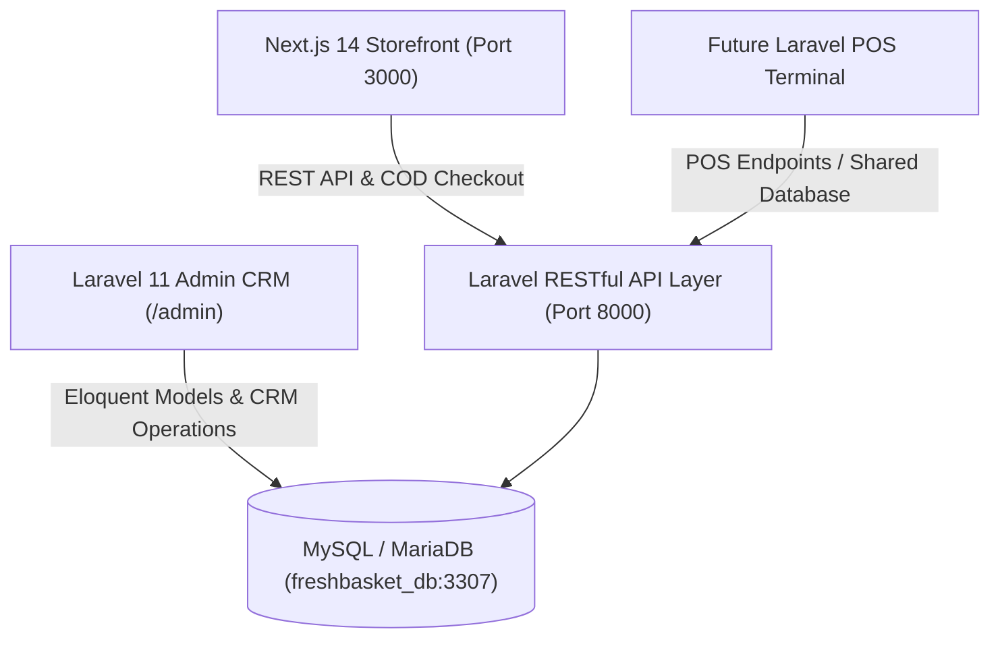

# Fresh Basket Pakistan — Full-Stack E-Commerce & CRM System

A full-stack, enterprise-grade replica and modern enhancement of [Fresh Basket Pakistan](https://freshbasket.com.pk/), engineered with **Laravel 11 (Backend, Admin CRM & RESTful API)**, **Next.js 14 / React (Storefront with Tailwind CSS)**, and **MySQL Database**.

---

## 🌟 Key Highlights & Enhancements
1. **Authentic Scraped Fresh Basket Catalog**:
   - 745+ products across 36 categories directly extracted from `freshbasket.com.pk`.
   - Real CDN images, genuine Pakistani Rupee (PKR) prices, descriptions, units (e.g. 500g, 1kg), SKUs, and barcodes.
2. **Future POS Ready (Physical Point-of-Sale Integration)**:
   - Built specifically for seamless connection to a future Laravel-based POS system for physical store counter sales.
   - Shares MySQL database (`freshbasket_db`) and models for unified real-time inventory deduplication, barcode lookup, and audit logs.
   - Dedicated POS endpoints: `/api/v1/pos/barcode/{code}`, `/api/v1/pos/checkout`, `/api/v1/pos/sync`.
3. **Complete Admin CRM & Control Panel (`/admin`)**:
   - **Executive Dashboard**: Gross sales (PKR), COD collected vs pending, total order volume, active customer count, low-stock warnings.
   - **Order Fulfillment & COD Reconciliation**: Complete status transitions (Pending $\rightarrow$ Processing $\rightarrow$ Dispatched $\rightarrow$ Delivered $\rightarrow$ Cash Collected), printable thermal packing slips for riders.
   - **Product & Inventory Center**: Barcodes, costs, margins, and 1-click stock adjustments with audit logging.
   - **Customer 360 CRM**: Customer lifetime spend, purchase history, order count, delivery address notes, and 1-click WhatsApp chat.
   - **POS & Stock Audit Trail**: Detailed record of all stock deductions across online sales and counter POS transactions.
   - **Support & Bulk Leads**: Customer inquiries and corporate fruit basket request management.
4. **Enhanced Next.js Storefront (`http://localhost:3000`)**:
   - Premium supermarket aesthetic with fast category pill navigation.
   - Debounced instant search with live product thumbnail previews and 1-click add.
   - Interactive sliding cart drawer with Karachi Free Delivery progress meter (Free over PKR 2,500).
   - Frictionless Cash on Delivery (COD) checkout modal with instant order confirmation and WhatsApp tracking.

---

## 🏗️ Architecture Overview



---

## 📁 Repository Structure

```
freshbasket/
├── backend/                   # Laravel 11 Backend & Admin CRM
│   ├── app/
│   │   ├── Console/Commands/  # ImportFreshBasketCatalog.php
│   │   ├── Http/Controllers/
│   │   │   ├── Admin/         # AdminController (CRM, Orders, Products, Customers)
│   │   │   └── Api/           # ProductController, CategoryController, CheckoutController, PosController
│   │   └── Models/            # Category, Product, ProductImage, Customer, Order, OrderItem, InventoryLog, CrmLead
│   ├── config/                # database.php, cors.php
│   ├── database/
│   │   ├── migrations/        # Core tables with POS-ready inventory & COD orders
│   │   └── seeders/           # AdminAndDemoSeeder.php
│   ├── resources/views/admin/ # Blade views with Tailwind CSS (Dashboard, Orders, Products, Slip, Customers)
│   └── routes/                # api.php, web.php
│
├── frontend/                  # Next.js 14 Storefront (Tailwind CSS, TypeScript, Lucide)
│   ├── src/
│   │   ├── app/               # App Router (page.tsx, layout.tsx, globals.css)
│   │   ├── components/        # Header, HeroBanner, CategorySlider, ProductCard, CartDrawer, CheckoutModal, Footer
│   │   ├── context/           # CartContext.tsx (Local storage persistence, delivery meter)
│   │   ├── lib/               # api.ts (REST API connector with fallback catalog)
│   │   └── types/             # TypeScript types
│
├── data/
│   └── freshbasket_catalog.json # 745+ Scraped products & 36 categories from freshbasket.com.pk
├── scrape_freshbasket.py      # Automated catalog crawler
├── run_servers.bat            # 1-Click launcher for both servers
└── README.md
```

---

## 🚀 Quick Start Guide

### 1. Database Setup
MySQL / MariaDB is pre-configured on port 3307 with database `freshbasket_db`:
```bash
# In backend/.env
DB_CONNECTION=mysql
DB_HOST=127.0.0.1
DB_PORT=3307
DB_DATABASE=freshbasket_db
DB_USERNAME=root
DB_PASSWORD=
```

### 2. Start Both Services
Double-click `run_servers.bat` OR run manually:

**Terminal 1 (Laravel Backend & CRM):**
```bash
cd backend
php artisan serve --port=8000
```
- Admin CRM: `http://127.0.0.1:8000/admin`
- REST API Base: `http://127.0.0.1:8000/api/v1`

**Terminal 2 (Next.js Storefront):**
```bash
cd frontend
npx next start -p 3000
# Or for dev mode: npm run dev
```
- Storefront: `http://localhost:3000`

---

## 🛒 Cash on Delivery (COD) Checkout Flow
1. Shopper browses products or uses instant search.
2. Items added to cart drawer; free delivery threshold progress bar updates automatically.
3. Clicks **"Proceed to COD Checkout"**.
4. Enters name, phone, Karachi delivery address, and rider notes.
5. Order placed via `POST /api/v1/checkout`:
   - Auto-generates Order number (e.g. `FB-D7HMVW`).
   - Deducts stock quantity and creates an `InventoryLog` entry for POS audit.
   - Synchronizes customer profile and lifetime value in CRM.
6. Order Confirmation modal appears with order details, exact cash due, and 1-click WhatsApp customer support link.
7. Order instantly reflects in Admin CRM (`/admin/orders`) where managers can print delivery packing slips and reconcile COD cash payments.

---

## 🏢 POS Integration Guide (Physical Counter Sales)
When connecting your physical store Laravel POS:
1. **Barcode Scanning**:
   `GET /api/v1/pos/barcode/{code}` — Instant scan item lookup returning price and stock.
2. **Counter Checkout**:
   `POST /api/v1/pos/checkout` — Records in-store walk-in sale, marks as paid (`pos_cash`), and deducts inventory with `reason='pos_sale'`.
3. **Full Inventory Sync**:
   `GET /api/v1/pos/sync` — Returns inventory catalog for offline/online POS sync.

---

## 👤 Admin Login Credentials
- **URL**: `http://127.0.0.1:8000/admin`
- **Email**: `admin@freshbasket.com.pk`
- **Password**: `admin12345`
